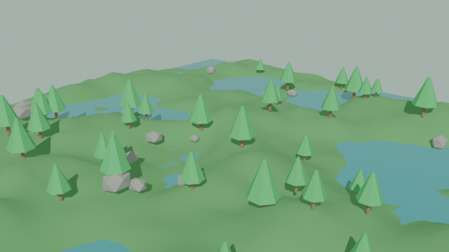
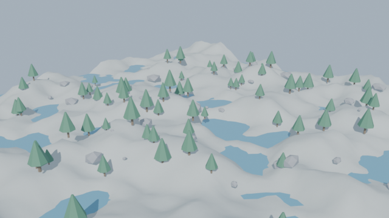
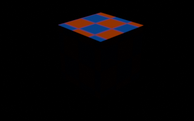

<p align="center">
  
</p>

<h1 align="center">Universal AI Game Studio</h1>

<p align="center">
  An evidence-driven game-development skill, toolchain and learning path for AI
  coding agents.
</p>

<p align="center">
  <a href="LEARNING.md">Learning guide</a> ·
  <a href="CONTRIBUTING.md">Contributing</a> ·
  <a href="LICENSE">MIT license</a>
</p>

Universal AI Game Studio helps an AI coding agent work like a small game team:
understand a game's requirements, inspect the real project and installed tools,
design a playable slice, implement the necessary systems, research assets
responsibly, test the result and report evidence.

This repository is a **reusable workflow and toolset, not a finished game**.
It does not replace engine-specific knowledge, human creative direction,
playtesting or review of license terms. The agent must use the actual project,
tools and MCP capabilities available to the current user rather than assuming
that a documented integration is installed or running.

## At a glance

- **Reusable game-development skill:** production gates, world and level design,
  gameplay architecture, animation, AI, audio/UI, testing and delivery guidance.
- **Multi-agent project rules:** OpenCode, Codex, Claude Code, GitHub Copilot,
  Cursor, Gemini CLI, Windsurf, Cline, Roo Code and Aider.
- **Blender MCP server:** a dependency-free local stdio server that launches
  Blender for real inspection, validation, import/export, rendering and Python
  operations.
- **Game Studio MCP server:** real detection, licensed asset search, Meshy
  generation, animation inspection and Unity/Godot/Unreal staging with explicit
  confirmation, provenance and limitations. See
  [tools/game-studio-mcp/README.md](tools/game-studio-mcp/README.md).
- **Environment detector:** read-only Windows tooling discovery that writes a
  local report, intentionally excluded from source control.
- **Asset research practices:** candidate evaluation, license checks,
  attribution and provenance recording.
- **Learning and contribution guides:** [LEARNING.md](LEARNING.md) and
  [CONTRIBUTING.md](CONTRIBUTING.md).

## Screenshots

These are **real outputs** produced by the tools in this repository, not mockups.

<table>
  <tr>
    <td width="50%">
      <br>
      <sub><code>blender_create_environment_blockout</code> · jungle · 80 m · 6,670 triangles</sub>
    </td>
    <td width="50%">
      <br>
      <sub><code>blender_create_environment_blockout</code> · alpine · 120 m · 12,194 triangles</sub>
    </td>
  </tr>
  <tr>
    <td colspan="2" align="center">
      <br>
      <sub>Blender MCP validation render — a test asset, not a finished game scene.</sub>
    </td>
  </tr>
</table>

The logo is an original SVG included at
[`assets/universal-ai-game-studio-logo.svg`](assets/universal-ai-game-studio-logo.svg).
Blockouts are seeded layout geometry for iteration; they are not production art
or a claim of finished gameplay.

## Table of contents

- [Screenshots](#screenshots)
- [Quick start](#quick-start)
- [Requirements](#requirements)
- [Use with AI agents](#use-with-ai-agents)
- [Configure Blender MCP](#configure-blender-mcp)
- [Configure Game Studio MCP](#configure-game-studio-mcp)
- [Run checks](#run-checks)
- [Production workflow](#production-workflow)
- [Asset research and licensing](#asset-research-and-licensing)
- [Repository map](#repository-map)
- [Troubleshooting](#troubleshooting)
- [Contributing](#contributing)
- [License](#license)

## Quick start

### 1. Clone the repository

```powershell
git clone https://github.com/mzainulabideendev/Universal-AI-Game-Studio.git
Set-Location .\Universal-AI-Game-Studio
```

### 2. Open it in your AI coding agent

Open the repository root as the workspace. The agent-specific project
instructions are already included; see [Use with AI agents](#use-with-ai-agents).
Start with a task-specific request, for example:

> Read the game-development skill, inspect this project and tell me which engine,
> version, tests and MCP tools are actually available. Do not edit files yet.

For a game project of your own, copy `AGENTS.md`, the instruction file for your
agent and the `.opencode/skills/` folder into that game's root. Then open the
game project in the agent. Do not copy machine-specific reports or personal MCP
configuration.

### 3. Check Python and discover local tools

Python 3.10 or later is required by the Blender MCP server.

```powershell
python --version
powershell -NoProfile -ExecutionPolicy Bypass -File .\scripts\detect-dev-environment.ps1
```

The detector is read-only and currently targets Windows. It writes
`reports/environment.json` and `reports/environment.md` locally; these files
may include hardware and absolute paths and are excluded from Git.

### 4. Discover the Game Studio tools

`tools/game-studio-mcp/server.py` is a second local stdio server that adds
cross-engine detection, licensed asset search, Meshy tasks and engine staging.
It has no third-party Python dependencies:

```powershell
python .\scripts\test-mcp-server.py --call studio_info -- python .\tools\game-studio-mcp\server.py
python .\scripts\test-mcp-server.py --call detect_game_engines -- python .\tools\game-studio-mcp\server.py
```

Configuration and credentials are external to the repository; see
[Game Studio MCP](tools/game-studio-mcp/README.md).

### 5. Verify MCP communication

This handshake-only test confirms that the Blender server initializes and lists
tools. It does **not** require Blender:

```powershell
python .\scripts\test-mcp-server.py -- python .\tools\blender-mcp\server.py
```

### 6. Optionally run the complete Blender pipeline test

Install Blender separately. Either make its executable available as `blender` on
`PATH`, or set `BLENDER_EXE` for the current shell:

```powershell
$env:BLENDER_EXE = 'C:\Path\To\Blender\blender.exe'
python .\scripts\test-blender-mcp.py --full
```

The full test creates a temporary cube scene, inspects and validates the scene,
exports a GLB, renders a PNG and checks that the artifacts exist. It does not
install software or modify a game project. The pipeline has been exercised with
Blender 5.2.2 LTS on Windows; that result does not prove a game's engine build or
runtime behavior.

## Requirements

| Requirement | Needed for | Notes |
| --- | --- | --- |
| Python 3.10+ | Blender MCP server and Python checks | No extra Python packages are needed for the included scripts. |
| Blender | Actual Blender operations and the full smoke test | Set `BLENDER_EXE` or make `blender` available on `PATH`. |
| PowerShell | Environment detector | The detector targets Windows. |
| Unity, Unreal or Godot | A project using that engine | Install only the engine/version needed by that project. |
| AI coding agent | Interactive agent workflow | Supported project rule files are included; MCP setup is client-specific. |

No engine is required to clone the repository or run the MCP handshake test.
Engine/editor integrations require their actual engine, project and editor-side
plugin or integration.

## Use with AI agents

Open this repository root in the agent. Use the existing rule file below; the
core game-production workflow is in
`.opencode/skills/universal-game-development-engineer/SKILL.md`.

| Agent/client | Project instructions | First setup |
| --- | --- | --- |
| OpenCode | `.opencode/skills/universal-game-development-engineer/SKILL.md` | Open the repo and ask the agent to use the **Universal Game Development Engineer** skill. |
| OpenAI Codex | `AGENTS.md` | Open the repository root as the Codex workspace. |
| Claude Code | `CLAUDE.md` | Start Claude Code from the repository root. |
| GitHub Copilot | `.github/copilot-instructions.md` | Open the repository in VS Code with Copilot Chat enabled. |
| Cursor | `.cursor/rules/universal-game-development-engineer.mdc` | Open the repository in Cursor and enable project rules. |
| Gemini CLI | `GEMINI.md` | Start Gemini CLI from the repository root. |
| Windsurf | `.windsurf/rules/game-development.md` | Open the repo in Windsurf and enable the project rule. |
| Cline | `.clinerules/game-development.md` | Open the repo in VS Code with Cline. |
| Roo Code | `.roo/rules/game-development.md` | Open the repo in VS Code with Roo Code. |
| Aider | `.aider.conf.yml` | Run Aider from the repository root. |

Agent versions and project-rule behavior can change. If a client does not load
its file automatically, use its current documented project-instructions feature
and point it to the listed file. A project rule provides context; it does not
install MCP servers, engines, packages or assets.

### Give the agent a useful task

Ask it to inspect before implementing, then give a concrete outcome and target.
For example:

> Inspect this Unity project and determine the current input system and render
> pipeline. Then propose the smallest tested change to make the player dash,
> including the files you would change. Do not modify project settings.

For a production request, include the game's core loop, target platform,
constraints, budget and what "done" means. Follow
[LEARNING.md](LEARNING.md) to understand the workflow and the evidence expected.

## Configure Blender MCP

`tools/blender-mcp/server.py` is a local **stdio MCP server**. Configure it in
the MCP settings supported by the agent you use:

- **Command:** `python` (or the full path to Python)
- **Argument:** `<repository-root>/tools/blender-mcp/server.py`
- **Working directory:** `<repository-root>`
- **Environment (optional):** `BLENDER_EXE` set to the absolute path of
  `blender.exe` when Blender is not on `PATH`

For example, if the client supports the VS Code workspace MCP format, create a
local `.vscode/mcp.json` with the following shape and replace the Blender path.
Keep machine-specific paths local; do not commit a personal config:

```json
{
  "servers": {
    "blender": {
      "type": "stdio",
      "command": "python",
      "args": [
        "${workspaceFolder}/tools/blender-mcp/server.py"
      ],
      "env": {
        "BLENDER_EXE": "C:\\Path\\To\\Blender\\blender.exe"
      }
    }
  }
}
```

The exact MCP settings location and user-interface steps depend on the client.
Reload its MCP configuration after editing, then discover the server's tools
and call `blender_info`. Check `unity status` and `unity pipeline list` before
using Unity editor tools; the editor must be running on the intended project.

## Configure Game Studio MCP

`tools/game-studio-mcp/server.py` is a separate stdio server for discovery,
assets, Meshy and engine staging. It uses the same MCP client configuration
shape:

```json
{
  "servers": {
    "game-studio": {
      "type": "stdio",
      "command": "python",
      "args": ["${workspaceFolder}/tools/game-studio-mcp/server.py"],
      "env": {
        "MESHY_API_KEY": "${env:MESHY_API_KEY}",
        "SKETCHFAB_TOKEN": "${env:SKETCHFAB_TOKEN}"
      }
    }
  }
}
```

`MESHY_API_KEY` and `SKETCHFAB_TOKEN` are optional; omit them to use only
keyless integrations. The server stores machine-local config outside the
repository (`GAME_STUDIO_HOME` overrides the location) and never returns secret
values.

If Meshy is not configured, call `meshy_setup_guide`. It returns the real key
creation steps and two supported storage options: set `MESHY_API_KEY` in the MCP
client environment and reconnect, or call `meshy_configure_api_key` with
`confirm=true` to validate and save the key in the private local config
directory. The environment variable wins; `meshy_clear_api_key` removes only the
local file. Keys can be rotated at any time by replacing either one.

Start with `studio_info`, `detect_game_engines` and `inspect_game_project`.
Credit-spending, file-writing and editor/build calls require an explicit
`confirm=true`. See the full
[tool and limitation reference](tools/game-studio-mcp/README.md).

## Run checks

### Python syntax

```powershell
python -m py_compile .\tools\blender-mcp\server.py .\scripts\test-blender-mcp.py .\scripts\test-mcp-server.py
```

### MCP handshake and advertised tools

```powershell
python .\scripts\test-mcp-server.py -- python .\tools\blender-mcp\server.py
python .\scripts\test-mcp-server.py -- python .\tools\game-studio-mcp\server.py
```

The script prints the server identity and tool names. A passing handshake tests
stdio protocol discovery only; use `--full` on the Blender test for real Blender
operations.

### Game Studio unit tests

```powershell
python -m unittest discover -s .\tools\game-studio-mcp\tests -v
```

These tests use temporary projects and synthetic GLB/OBJ files. They need no
network, engine, Blender or API key.

### Blender create/inspect/validate/export/render workflow

```powershell
$env:BLENDER_EXE = 'C:\Path\To\Blender\blender.exe'
python .\scripts\test-blender-mcp.py --full
```

### Environment discovery (Windows)

```powershell
powershell -NoProfile -ExecutionPolicy Bypass -File .\scripts\detect-dev-environment.ps1
```

This is a tool-discovery report, not a game test. For a real game change, also
run the target project's focused unit/EditMode tests, play/integration tests,
build and runtime log checks as applicable.

## Production workflow

For a complete-game request, read
`.opencode/skills/universal-game-development-engineer/references/05-production-pipeline.md`.
Adapt the milestone gates to project scale; do not skip a critical gate merely
to produce a longer feature list.

1. **Foundation:** discover engine/version, project structure, architecture,
   MCP/editor state, baseline tests and build.
2. **Playable vertical slice:** implement one representative core loop with a
   real player controller, environment, interactions, fail/win flow and minimal
   wired UI.
3. **Content:** develop reachable, intentional levels; add validated assets,
   characters, animation, enemy behavior and audio required by the design.
4. **Feature completion:** wire menus, settings, progression, saves, results and
   level flow to real game state where the game needs them.
5. **Polish:** review controls, readability, accessibility, balance, visuals,
   audio, responsiveness and presentation.
6. **QA and performance:** run focused and regression tests, profile target
   devices, build, launch and inspect logs.
7. **Delivery:** provide source, build instructions, asset notices, measured
   evidence and explicit known limitations.

The skill contains 14 focused references, covering engine selection, production
gates, asset research, Unity, world design, Unreal/Godot, Blender, gameplay,
character/AI, testing, art/audio/UI, troubleshooting, acceptance and delivery.
See the
[reference index](.opencode/skills/universal-game-development-engineer/SKILL.md#reference-index).

### Reference guide

| Guide | Use it when you need to... |
| --- | --- |
| [Engine selection](.opencode/skills/universal-game-development-engineer/references/00-engine-selection.md) | Choose or create a project with an appropriate installed engine. |
| [Production pipeline](.opencode/skills/universal-game-development-engineer/references/05-production-pipeline.md) | Plan a full game through roles, milestones, gates and evidence. |
| [Art and asset research](.opencode/skills/universal-game-development-engineer/references/05b-autonomous-art-asset-research.md) | Define art direction and research assets, licenses and provenance. |
| [Unity](.opencode/skills/universal-game-development-engineer/references/10-unity.md) | Inspect Unity projects, editor MCP, tests, imports and builds. |
| [World and level design](.opencode/skills/universal-game-development-engineer/references/15-world-and-level-design.md) | Plan a traversable world, route, objectives, blockout and procedural level. |
| [Unreal and Godot](.opencode/skills/universal-game-development-engineer/references/20-unreal-godot.md) | Follow engine-specific Unreal or Godot workflows. |
| [Blender pipeline](.opencode/skills/universal-game-development-engineer/references/30-blender-asset-pipeline.md) | Inspect, validate, export and verify Blender assets in an engine. |
| [Gameplay systems](.opencode/skills/universal-game-development-engineer/references/40-gameplay-systems.md) | Design and implement game rules, systems and loops. |
| [Characters and AI](.opencode/skills/universal-game-development-engineer/references/45-character-ai.md) | Integrate character animation and functional enemy behavior. |
| [Testing and builds](.opencode/skills/universal-game-development-engineer/references/50-testing-and-builds.md) | Define test matrices and verify target builds. |
| [Art, audio and UI](.opencode/skills/universal-game-development-engineer/references/55-art-audio-ui.md) | Establish visual direction and wire audio/UI to live gameplay. |
| [Troubleshooting](.opencode/skills/universal-game-development-engineer/references/60-troubleshooting.md) | Diagnose common engine, import, physics and runtime failures. |
| [Acceptance checklist](.opencode/skills/universal-game-development-engineer/references/70-acceptance-checklist.md) | Report completion with evidence and limitations. |
| [Performance and delivery](.opencode/skills/universal-game-development-engineer/references/75-performance-qa-delivery.md) | Profile, test, package and hand off a project. |

### Evidence vocabulary

Use precise status language in reports:

- **Configured:** a setting or integration exists.
- **Implemented:** the requested code/content change exists.
- **Compiled:** the relevant build/compiler completed successfully.
- **Tested:** a named automated or manual test exercised the behavior.
- **Verified:** the running engine/build was observed and relevant logs checked.
- **Blocked:** a specific dependency or limitation prevented verification.

A configuration is not proof of a connection; a successful compile is not proof
that a gameplay feature works; a successful build is not proof that runtime logs
are clean.

## Asset research and licensing

Before using external assets, evaluate the exact asset, source, engine
compatibility, visual fit, technical budget and license. Record at least:

- Asset name, creator and source page.
- Exact license and required attribution.
- Commercial use, modification and redistribution terms.
- Dependencies and required notices.
- Date checked, file hash when practical, and project destination.

Do not silently purchase assets, bypass access controls, scrape where prohibited,
or ship assets with unclear rights. Keep third-party terms distinct from this
repository's license. See
`.opencode/skills/universal-game-development-engineer/references/05b-autonomous-art-asset-research.md`
and
`.opencode/skills/universal-game-development-engineer/references/30-blender-asset-pipeline.md`.

## Repository map

| Path | Purpose |
| --- | --- |
| `.opencode/skills/universal-game-development-engineer/SKILL.md` | Main game-development skill and task workflow |
| `.opencode/skills/universal-game-development-engineer/references/` | Engine, production, art, gameplay, testing and delivery references |
| `AGENTS.md`, `CLAUDE.md`, `GEMINI.md` | Shared agent rules and CLI-specific entry points |
| `.github/`, `.cursor/`, `.windsurf/`, `.clinerules/`, `.roo/` | Editor/agent project rules |
| `.aider.conf.yml` | Aider read-only instruction context |
| `scripts/detect-dev-environment.ps1` | Read-only Windows environment detector |
| `scripts/test-mcp-server.py` | Generic MCP stdio handshake and tool-list test |
| `scripts/test-blender-mcp.py` | Blender MCP smoke test; `--full` runs the full test pipeline |
| `tools/blender-mcp/server.py` | Dependency-free Blender MCP stdio server |
| `tools/game-studio-mcp/` | Game Studio MCP server, tests and limitations reference |
| `validation/assets/` | Small Blender test scene and checker texture |
| `validation/exports/` | Test FBX/GLB exports and real Blender preview render |
| `LEARNING.md` | Guided learning and practical exercises |
| `CONTRIBUTING.md` | Contribution workflow and review checklist |
| `LICENSE` | MIT license for repository-owned content |

## Troubleshooting

| Symptom | Check |
| --- | --- |
| Blender tools do not appear | Reload MCP settings, verify the command and script path, then run the handshake test. |
| Game Studio tools are not configured with Meshy | Set `MESHY_API_KEY` in the MCP server environment and reconnect. The server reports `not-configured` rather than faking a task. |
| Staged asset never appears in the engine | Staging is not import. Open/focus the engine, run the documented refresh tool, then check `verify_staged_import` and the engine log. |
| Blender starts but reports it is missing | Set `BLENDER_EXE` to the actual executable or add Blender to `PATH`. |
| `blender_info` works but asset calls fail | Check Blender's path/version and inspect the call's returned error and stderr. |
| Unity MCP exposes no editor tools | Open the intended Unity project, check `unity status` and `unity pipeline list`, and confirm the editor integration is enabled. |
| A model has no material or looks wrong | Inspect the source asset, validate its textures and import settings, then verify it in the target engine. |
| A game builds but fails at runtime | Launch the build, collect its player log, inspect exceptions and test the actual core loop. |
| The environment detector finds no engine | Check the engine's actual executable path and project version; do not treat a missing detection result as proof the project is broken. |

Do not hide failures behind fallback success messages. Capture the precise error,
make a focused diagnosis, and report any remaining limitation.

## Contributing

Bug reports, documentation improvements, agent setup fixes and tested workflow
improvements are welcome. Read [CONTRIBUTING.md](CONTRIBUTING.md) before opening
an issue or pull request.

## Learning

New users and contributors can follow the hands-on path in
[LEARNING.md](LEARNING.md), from reading agent instructions through testing the
Blender MCP workflow and practicing a production milestone.

## License

Repository-owned content is licensed under the [MIT License](LICENSE), copyright
(c) 2026 `mzainulabideendev`. Third-party material and external game assets, if
any, remain subject to their own licenses and notices. No standalone third-party
game asset library is intended to be bundled by this repository.
