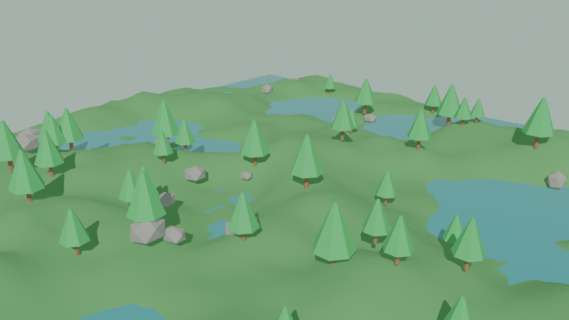
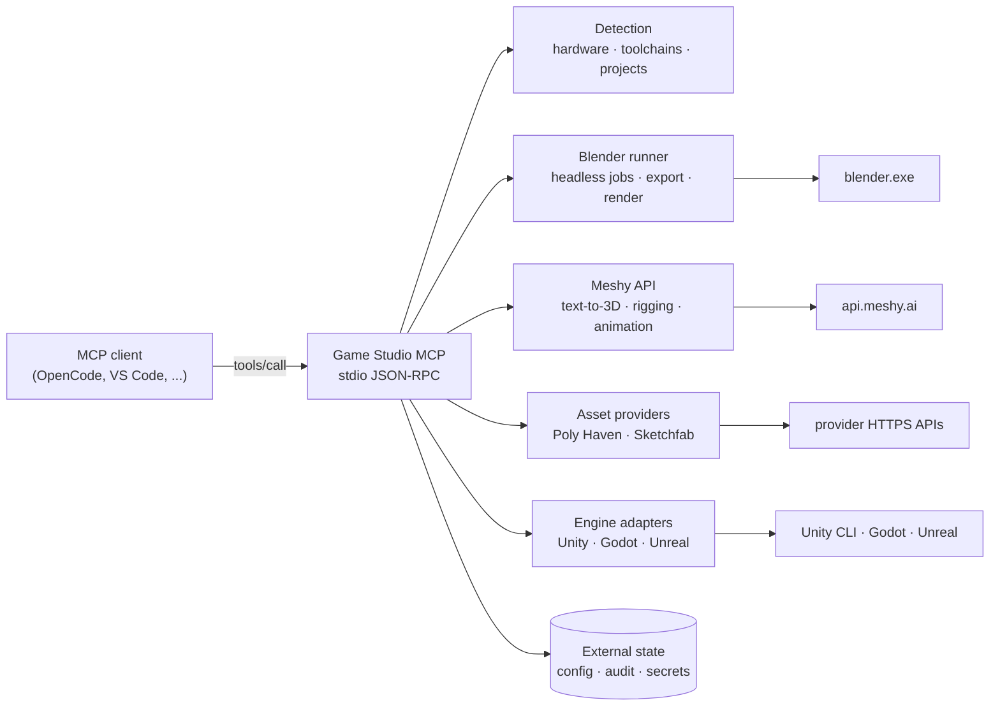
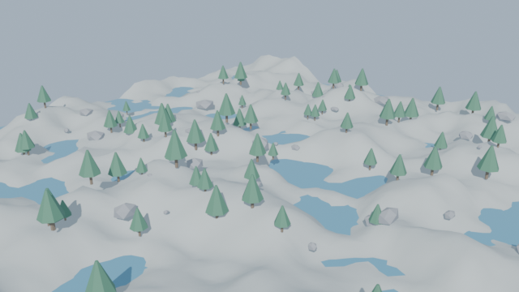
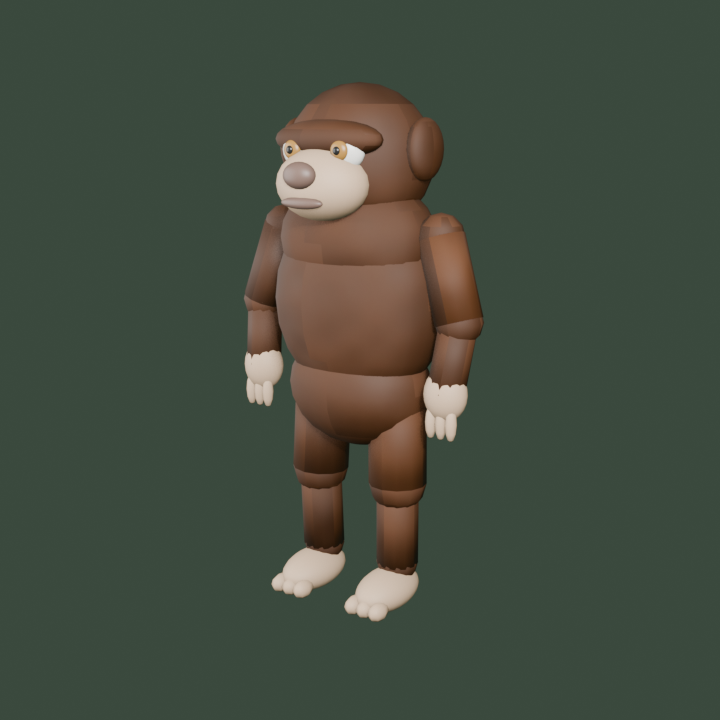
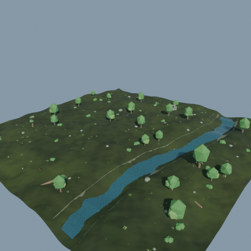
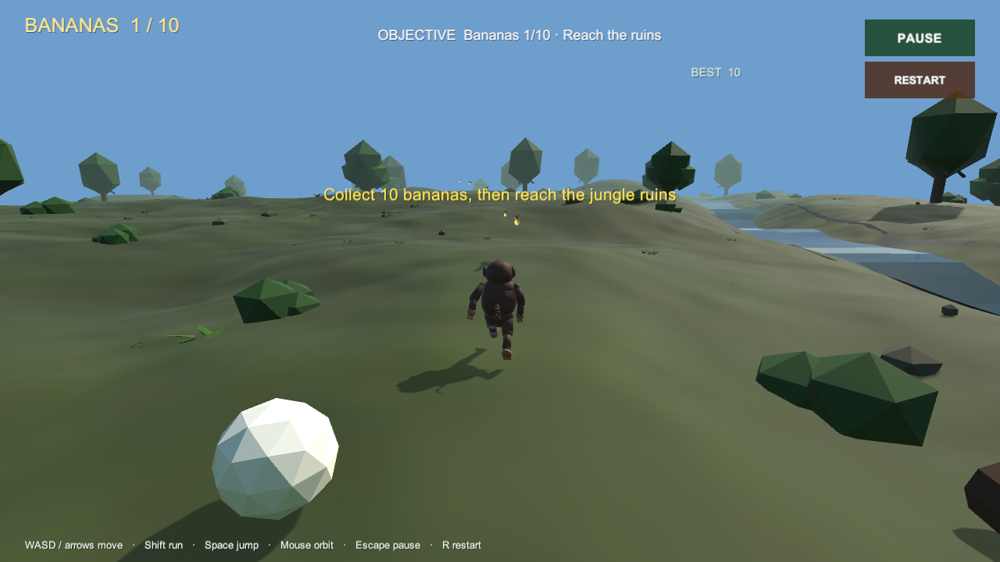

# Universal AI Game Studio MCP


A dependency-free Python stdio **Model Context Protocol** server for real game
production work: request understanding (English, Roman Urdu, Urdu, mixed),
specification and dependency planning, system and engine detection, Blender
automation, Meshy AI tasks, licensed asset search, animation inspection,
Unity/Unreal/Godot staging and CLI builds, and persistent project memory with
requirement traceability.

The server is built around one rule: **report what actually happened**. A staged
file is not called imported, a produced build is not called a working game, and a
missing provider or engine is reported as missing rather than simulated.



*Real output: `blender_create_environment_blockout` (`jungle`, seed 4242, 80 m)
produced this 640×360 EEVEE render, a `.blend` and a `.glb` (6,670 triangles).
Blockouts are iteration geometry, not production art.*

---

## Contents

- [Why this server exists](#why-this-server-exists)
- [Architecture](#architecture)
- [Request understanding and project memory](#request-understanding-and-project-memory)
- [LLM reasoning layer](#llm-reasoning-layer)
- [Screenshots](#screenshots)
- [Requirements](#requirements)
- [Quick start](#quick-start)
- [Configuration](#configuration)
- [Tool reference](#tool-reference)
- [Confirmation and overwrite model](#confirmation-and-overwrite-model)
- [Security and portability](#security-and-portability)
- [Validation performed](#validation-performed)
- [Known limitations](#known-limitations)
- [Project layout](#project-layout)
- [Development](#development)

## Why this server exists

Game studios lose time to integrations that look connected but are not. This
server makes the integration boundary explicit and auditable:

- **Real processes.** Blender, Unity CLI and Godot are invoked as subprocesses;
  engine projects are parsed from their actual project files.
- **Real providers.** Only APIs with documented public endpoints are automated
  (Poly Haven, Sketchfab, Meshy). Providers without one are marked `manual-only`.
- **Provenance by default.** Downloads and staged assets keep license, source
  URL, hashes and timestamps beside the files.
- **Explicit risk gates.** Spending credits, writing files, editing projects or
  starting builds requires `confirm=true`.
- **Honest capability states.** `available`, `implemented-unverified`,
  `not-configured`, `unavailable` and `manual-only` are distinct states.

## Architecture



The server has no Python package dependencies. It is a single stdio process that
can be launched by any MCP-capable client.

## Request understanding and project memory

The intelligence layer turns free-form requests into an approved, persistent
plan before any code is written:

```text
analyze_game_request
  -> explicit / implied / technical / optional / unresolved requirements
  -> exclusions, conflicts, language report and at most five material questions
create_game_specification
  -> engine-aware spec, character/environment/animation plans,
     dependency graph, milestones A-G and acceptance tests
init_project_manifest
  -> <project>/.game-studio/manifest.json (confirmed write)
update_requirement_status / record_project_decision
  -> evidence-backed progress across sessions
compare_project_against_requirements
  -> re-check claims against the real project before reporting
```

It recognises common English, Roman Urdu and Urdu production vocabulary
(`banao`, `bandar`, `charh`, `tair`, `jungle`, `bandar`, `گاڑی`, `جنگل`, ...).
The parser is deterministic, not a translator: unknown dialects produce a
clarifying question rather than a guess.

Classification is explicit:

| Class | Source | Example |
| --- | --- | --- |
| explicit | the user's words | "3D", "monkey", "drifting" |
| implied | genre engineering | racing -> lap tracking, vehicle physics |
| technical | engine/dimension dependency | 3D import pipeline, input actions |
| optional | AI suggestion | weather, photo mode, ranked matchmaking |
| unresolved | missing decision | engine, platform, online vs local |

The manifest survives agent restarts and stores the specification, requirement
statuses, evidence, decisions, pending questions, known errors and a bounded
history. Credential-like keys and values are refused. A requirement is only
`verified` with test, build, playtest or inspection evidence; creating a file is
never enough.

```text
analyze_game_request  -> read-only
create_game_specification -> read-only, awaiting approval
init_project_manifest / update_requirement_status / record_project_decision
                      -> writes, require confirm=true
get_project_manifest / track_project_progress / compare_project_against_requirements
                      -> read-only
```

Known limitation: the intent parser is a vocabulary and heuristic engine. It
does not claim perfect natural-language understanding, and its output must be
reviewed by the user before approval.

## LLM reasoning layer

The deterministic parser above remains the offline default. An optional,
provider-independent LLM layer adds reasoning on top of it without gaining any
execution power:

```text
user text (any language the model supports)
  -> llm_understand_request        classified requirements + language report
  -> llm_analyze_ambiguities       max 5 material questions; assumptions labelled
  -> llm_engine_compatibility      engine trade-offs grounded in real detection
  -> llm_plan_architecture         systems, dependencies, asset/animation plans
  -> llm_validate_plan             structural validation; deterministic verdict wins
  -> llm_build_execution_plan      governed, allow-listed MCP steps (never executable)
  -> llm_trace_requirements        understanding -> spec -> manifest trace map
  -> llm_game_director_plan        combined plan for new or existing projects
```

Supported adapters: OpenAI, OpenAI-compatible endpoints, Anthropic, Gemini and
Ollama. Configuration is entirely environment-driven (see
[Configuration](#configuration)); no credential is ever printed, logged or
returned.

**Hard boundary.** The LLM reasons; MCP tools execute. Model output can never run
a command, download an asset, spend credits, edit a project, change a
requirement status, grant permissions or change execution mode. Execution plans
are declarative (`executable: false`), name only tools from the server's
allow-list, and mark paid steps as requiring explicit approval
(`requires_confirm: true`); nothing is auto-approved.

**Fallback.** With no provider, no approval, a provider failure, an unrecoverable
schema error or an exceeded context/budget limit, the server returns the
deterministic result and labels it:

```json
{
  "source": "deterministic-fallback",
  "degraded": true,
  "fallback_reason": "..."
}
```

Fallback output is never presented as LLM understanding.

**Privacy.** Project content is not sent to a provider unless all three of
`GAME_STUDIO_LLM_ALLOW_PROJECT_CONTENT=true`, `include_project_content=true` and
`confirm=true` are present. Credential-shaped strings are redacted before
prompts are built, and request budgets, per-day limits, timeouts, bounded
retries and local-only mode bound cost and exposure.

Full details:
[architecture](docs/llm-architecture.md) ·
[provider setup](docs/llm-provider-setup.md) ·
[security and privacy](docs/llm-security-privacy.md) ·
[schemas](docs/llm-schemas.md) ·
[testing](docs/llm-testing.md) ·
[troubleshooting](docs/llm-troubleshooting.md) ·
[MCP integration](docs/llm-mcp-integration.md) ·
[limitations](docs/llm-limitations.md).

## Screenshots

These are real renders produced by the server in this repository's verification
run — not mockups or concept art.

| Jungle blockout | Alpine blockout |
| --- | --- |
|  |  |
| `preset=jungle`, seed 4242, 80 m, 6,670 triangles | `preset=alpine`, seed 2027, 120 m, 12,194 triangles |

Both images were rendered through `blender_create_environment_blockout` using
the real Blender executable found at runtime. A render-only request (no
`save_blend`) now stages a temporary `.blend` and removes it after rendering;
this path is covered by a unit test.

### Real character and level from the asset pipelines

These are the actual Phase 3/4 pipeline outputs, not mockups. The character is
procedurally built in Blender, validated, exported and re-imported; the level is
built around it and includes the validated character at the spawn.

| JungleMonkey (`character_generate_asset`) | JungleLevel (`environment_generate_asset`) |
| --- | --- |
|  |  |
| 15,688 triangles · 23 bones · 7 materials · Idle/Walk/Run/Jump · 3 × 512² PBR maps | 120 m × 120 m · 26,394 triangles · 19 materials · river, ruins and 9-waypoint route |



The gameplay frame above was captured at 1280×720 from the built Windows player
(Unity 6000.6.2f1), not from the editor. Full measurements and validation
evidence are in the repository root README section
[“V6 real character, environment and built game”](../../README.md#v6-real-character-environment-and-built-game).

## Requirements

| Component | Requirement |
| --- | --- |
| Python | 3.10+ (verified with 3.12.10) |
| Python packages | none |
| Blender | optional; 3.x, 4.x or 5.x (verified with 5.2.2 LTS) |
| Unity | optional; Editor plus Unity CLI (verified CLI 1.0.0-beta.8) |
| Unreal | optional; staged-only adapter, no editor automation |
| Godot | optional; 4.x CLI |
| Meshy key | optional; required only for Meshy tools |
| Sketchfab token | optional; authenticated search only |
| LLM provider | optional; OpenAI, OpenAI-compatible, Anthropic, Gemini or Ollama |

## Quick start

1. Clone the repository.
2. Register the server with your MCP client:

```json
{
  "servers": {
    "game-studio": {
      "type": "stdio",
      "command": "python",
      "args": ["${workspaceFolder}/tools/game-studio-mcp/server.py"],
      "env": {
        "MESHY_API_KEY": "${env:MESHY_API_KEY}",
        "SKETCHFAB_TOKEN": "${env:SKETCHFAB_TOKEN}"
      }
    }
  }
}
```

3. Start read-only:

```text
studio_info
detect_game_engines
inspect_game_project
```

4. Read the capability report before mutating anything:

```text
inspect_engine_capabilities
```

### Meshy key onboarding

When Meshy is selected without a key, the server returns `not-configured` and
points to `meshy_setup_guide`. No task is faked.

1. Create or sign in to a Meshy account at <https://www.meshy.ai/>.
2. Open <https://www.meshy.ai/developers/keys> and create a key, optionally with
   a monthly credit limit.
3. Copy it once — Meshy does not show it again.
4. Choose one storage method:
   - set `MESHY_API_KEY` in the MCP client environment and reconnect, or
   - call `meshy_configure_api_key` with `confirm=true`; the key is validated
     against the balance endpoint before it is saved.
5. Call `meshy_balance` to confirm access.

Rotation is supported at any time: create a new key, call
`meshy_configure_api_key` again, then revoke the old key. The environment
variable takes precedence over the local file. `meshy_clear_api_key` removes the
local file only. No tool returns the key, and it never enters the audit log.

## Configuration

Machine-local state lives outside the repository:

| Platform | Location |
| --- | --- |
| Windows | `%APPDATA%\UniversalAIGameStudio\` |
| macOS | `~/Library/Application Support/UniversalAIGameStudio/` |
| Linux | `$XDG_CONFIG_HOME/universal-game-studio/` |
| Override | `GAME_STUDIO_HOME` |

`configure_studio` and `select_game_engine` manage paths and the selected engine.
Default project roots are limited to common folders that already exist on the
machine and are never written into the repository.

| Variable | Purpose | Default |
| --- | --- | --- |
| `MESHY_API_KEY` | Meshy API access | unset |
| `SKETCHFAB_TOKEN` | Authenticated Sketchfab search | unset |
| `BLENDER_EXE` | Blender executable | auto-detected / `PATH` |
| `GAME_STUDIO_HOME` | Config, audit, secrets, downloads | OS config directory |
| `GAME_STUDIO_ENGINE_TIMEOUT` | Engine command timeout (seconds) | `1800` |
| `BLENDER_MCP_TIMEOUT` | Blender job timeout (seconds) | `900` |
| `GAME_STUDIO_LLM_PROVIDER` | `openai`, `openai_compatible`, `anthropic`, `gemini`, `ollama` | `openai` |
| `GAME_STUDIO_LLM_MODEL` | Provider model id | provider default |
| `GAME_STUDIO_LLM_BASE_URL` | Custom compatible endpoint | provider default |
| `GAME_STUDIO_LLM_API_KEY` | Preferred shared LLM key (never commit) | unset |
| `OPENAI_API_KEY` / `ANTHROPIC_API_KEY` / `GEMINI_API_KEY` | Provider-specific keys | unset |
| `GAME_STUDIO_LLM_LOCAL_ONLY` | `true` refuses hosted providers | `false` |
| `GAME_STUDIO_LLM_MAX_TOKENS` | Output token budget per request | `4096` |
| `GAME_STUDIO_LLM_MAX_REQUESTS` | Session request budget | `20` |
| `GAME_STUDIO_LLM_MAX_REQUESTS_PER_DAY` | Daily request budget | `200` |
| `GAME_STUDIO_LLM_TIMEOUT` | Request timeout (seconds) | `60` |
| `GAME_STUDIO_LLM_RETRIES` | Bounded exponential-backoff retries | `2` |
| `GAME_STUDIO_LLM_CACHE` | Cache non-sensitive prompts locally | `false` |
| `GAME_STUDIO_LLM_ALLOW_PROJECT_CONTENT` | Allow sending project context externally | `false` |

## Tool reference

84 tools, grouped by capability.

### Understanding, specification and project memory

`analyze_game_request`, `create_game_specification`, `init_project_manifest`,
`get_project_manifest`, `update_requirement_status`, `record_project_decision`,
`track_project_progress`, `compare_project_against_requirements`.

See [Request understanding and project memory](#request-understanding-and-project-memory)
for the workflow and evidence rules.

### Discovery and configuration

`studio_info`, `detect_system`, `detect_game_engines`, `list_available_engines`,
`select_game_engine`, `inspect_engine_capabilities`, `inspect_game_project`,
`configure_studio`, `list_studio_projects`, `read_studio_audit`.

### Blender

`blender_info`, `blender_inspect_blend`, `blender_validate_asset`,
`blender_export_asset`, `blender_import_asset`, `blender_render_preview`,
`blender_create_environment_blockout`, `blender_run_python`.

`blender_create_environment_blockout` generates a reproducible terrain blockout
(`jungle`, `forest`, `desert`, `alpine`) with trees, rocks, water, sun and camera.
It is explicitly a blockout, not production environment art.

`blender_run_python` executes arbitrary Blender Python and requires
`confirm=true`.

### Meshy

`meshy_setup_guide`, `meshy_configure_api_key`, `meshy_clear_api_key`,
`meshy_balance`, `meshy_text_to_3d`, `meshy_rig_character`,
`meshy_animation_library`, `meshy_create_animation`, `meshy_task_status`,
`meshy_wait_for_task`, `meshy_download_output`, `meshy_generate_asset`.

All credit-spending calls require `confirm=true` and record an audit entry.
Rigging targets humanoid/biped models. Meshy returns GLB/FBX files; it does not
configure a Unity Animator, Unreal Animation Blueprint or Godot AnimationPlayer.
Inspect the rig and verify import and playback before claiming a character is
ready.

### Assets

`list_asset_providers`, `search_assets`, `download_polyhaven_asset`,
`inspect_asset_license`, `validate_asset_file`, `create_asset_manifest`.

| Provider | Search | Download | License handling |
| --- | --- | --- | --- |
| Poly Haven | yes, keyless | yes | CC0, MD5 verified, provenance file |
| Sketchfab | yes, token optional | no | per-asset license field; missing data flagged |
| Meshy | generated assets | yes | Meshy terms |
| Mixamo, Kenney, OpenGameArt, Unity Asset Store, Fab | no | no | `manual-only`; use the provider's own site |

The server does not scrape manual-only providers or bypass access controls.

### Animation

`inspect_animation_rig`, `create_animation_retarget_map`,
`check_animation_compatibility`, `list_animation_sources`.

Parses GLB/glTF skeletons and clips, classifies humanoid vs quadruped/generic
heuristically, and produces a bone-name map. A name map is not proof of correct
retargeting; verify rest pose, scale, axes and playback in Blender or the engine.

### Engines

`stage_asset_for_engine`, `verify_staged_import`, `engine_build`,
`unity_editor_status`, `unity_list_commands`, `unity_run_command`,
`unity_batch_refresh`, `unity_run_tests`, `unity_build`,
`godot_batch_import`, `godot_build`, `unreal_status`.

| Engine | Inspect | Stage | Import verification | Refresh | Tests | Build |
| --- | --- | --- | --- | --- | --- | --- |
| Unity | yes | yes | `.meta` + hash | `unity run -quit -batchmode` | `unity test` + NUnit parse | `unity build` + artifact check |
| Godot | yes | yes | `.import` + `.godot/imported` | `godot --headless --editor --quit` | not implemented | export preset |
| Unreal | yes | yes | requires editor automation | no | no | no |

The Unreal adapter is deliberately staged-only. It does not claim an import or a
build succeeded.

### Governance, operations and verification

`get_execution_mode`, `set_execution_mode`, `set_permission`, `list_operations`,
`get_operation`, `cancel_operation`, `cleanup_operation`, `operation_status`,
`recover_operations`, `inspect_requirement_evidence`,
`run_requirement_verification`.

Execution modes (`guided`, `balanced`, `autonomous`) and per-capability
permissions (`allow` / `ask` / `deny`) bound what any tool or plan may do.
Long-running operations are persisted with cancellation state. Requirement
evidence is inspected and re-run through a caller-supplied argv validation
command; only this path can change a requirement to `verified`.

### LLM reasoning

`llm_status`, `llm_understand_request`, `llm_generate_specification`,
`llm_analyze_ambiguities`, `llm_engine_compatibility`, `llm_plan_architecture`,
`llm_validate_plan`, `llm_build_execution_plan`, `llm_trace_requirements`,
`llm_test_provider`, `llm_review_plan`, `llm_game_director_plan`.

See [LLM reasoning layer](#llm-reasoning-layer). These tools reason only; they do
not execute engine, asset or build operations. `llm_test_provider` sends one
small real request and proves reachability, not output quality.

## Confirmation and overwrite model

These calls fail unless `confirm=true`:

- Meshy text-to-3D, refine, rigging and animation tasks (credits).
- Poly Haven downloads.
- Asset staging into a game project.
- Unity batch refresh, tests, builds and editor commands.
- Godot import and export.
- `blender_run_python`.
- `init_project_manifest`, `update_requirement_status` and `record_project_decision`
  (project-memory writes).

Exports, renders and staging refuse to replace an existing target unless
`confirm_overwrite=true`. Every confirmed write is appended to a local JSONL
audit log.

## Security and portability

- Subprocesses run without a shell. Blender receives arguments through a JSON
  file rather than string interpolation.
- Downloads use HTTPS with provider host allow-lists, size limits and private
  address rejection. Poly Haven files are MD5-checked; all downloads are
  SHA-256 hashed.
- Staged paths must stay inside the project's `Assets/`, `Content/` or root.
  Traversal and absolute paths are rejected.
- API keys are resolved at call time and never written to config, audit output
  or tool responses.
- The local secrets file is created under the external config directory with
  owner-only permissions where the platform supports them.
- No machine paths or credentials are committed to the repository.

## Validation performed

Environment: Windows, Python 3.12.10, Blender 5.2.2 LTS, Unity 6000.6.2f1 and
Unity CLI 1.0.0-beta.8.

```powershell
python -m compileall -q .\tools\game-studio-mcp
python -m unittest discover -s .\tools\game-studio-mcp\tests -q   # 150 passed
python .\scripts\validate-intent-memory.py
python .\scripts\llm-demo.py --json                 # deterministic offline pipeline
python .\scripts\llm-demo.py --mock-llm --json      # mocked provider pipeline
python .\scripts\test-mcp-server.py --call studio_info -- python .\tools\game-studio-mcp\server.py
python .\scripts\test-mcp-server.py --call blender_info -- python .\tools\game-studio-mcp\server.py
```

| Evidence | Result |
| --- | --- |
| MCP stdio handshake | 84 tools; every tool has a handler |
| Unit tests | 150 passing, mostly offline; LLM provider tests use mocked HTTP (no keys, no paid calls) |
| Intent/memory validation | Roman Urdu request understood; 22 requirements; 33-node acyclic graph; manifest reload; evidence guards enforced |
| LLM offline demo | full English monkey/Android request; deterministic fallback labelled; spec + trace + execution plan |
| LLM mocked-provider demo | `source: llm`, schema-valid spec, `validation: valid`, 19 governed steps (14 available, 3 paid-blocked, 2 blocked) |
| Blender jungle blockout | `.blend` 196,461 B; `.glb` 283,272 B, 57 meshes, 5 materials; 640×360 PNG 278,904 B |
| Blender alpine render | 12,194 triangles, 114 objects, 640×360 PNG 287,522 B |
| Render-only path | temporary `.blend` created and removed; render persisted |
| Poly Haven live search | `rock_moss_set_02`, `rock_moss_set_01`, `Rockingchair_01`, HDRIs |
| Unity detection | 6000.6.2f1 editor and CLI detected; real project inspected |
| Unity editor tools | correctly reported unavailable (no connected Pipeline editor) |
| Meshy invalid key | real 401 response, `saved: false`, no key file written |
| Meshy key storage | local save, environment precedence and clear tested |
| LLM live provider | **not verified** — no credential or local model was used; adapters are wire-format tested only |

Reproduction notes and the full evidence table are in
[ACCEPTANCE.md](ACCEPTANCE.md).

## Known limitations

- **Intent understanding is heuristic.** The lexicon covers common English,
  Roman Urdu and Urdu game vocabulary. It is deterministic and traceable, but it
  is not a general translator; unusual dialects or metaphors require a
  clarifying question. User approval of the specification is mandatory. The
  optional LLM layer can improve coverage, but its output is equally advisory.
- **No LLM provider was live-verified.** All five adapters are implemented and
  covered by mocked-HTTP wire-format tests. No credential or local model was
  available, so live reachability, rate-limit behaviour and real output quality
  are unconfirmed. Use `llm_test_provider` to prove reachability in your own
  environment.
- **LLM plans are proposals.** Architecture, engine recommendations, risks and
  execution steps are not evidence of implementation. Execution plans are
  abstract (tool names, no concrete arguments) and always `executable: false`.
- **LLM cost and context are approximate.** Budgets count requests, not currency,
  and the context guard uses a local character approximation rather than a
  model-specific tokenizer.
- **Requirement comparison checks evidence existence, not correctness.** A
  `verified` status means qualifying evidence was recorded and its files exist;
  it is not an independent re-run of the test, build or playtest.
- **Meshy task execution is unverified.** No valid key was available. Key setup,
  validation, storage and rejection paths are tested; live generation, rigging
  and animation tasks are not.
- **Unity writes are unverified.** No editor with `com.unity.pipeline` was
  connected, and no batch refresh, test run or player build was executed in this
  environment.
- **Unreal is staged-only.** UE is not installed; inspection/staging logic is
  fixture-tested, but there is no editor automation.
- **Godot is unexecuted.** CLI syntax follows the documented interface; it was
  not run against a Godot installation.
- **Sketchfab authenticated search is unverified.** No token was supplied.
- **No runtime playtesting.** No generated asset, staging result or build has
  been played. Blockouts are placeholders and require production art, collision
  and gameplay validation.
- **Blockouts are not art direction.** They are seeded geometry for layout
  iteration, not a substitute for an environment artist.

## Project layout

```text
tools/game-studio-mcp/
├── server.py                 # MCP registry and stdio transport
├── game_studio/
│   ├── config.py             # external config + audit trail
│   ├── secrets.py            # private Meshy key resolution/storage
│   ├── util.py               # path safety, hashing, HTTP, subprocesses
│   ├── understanding.py      # multilingual intent + requirement classification
│   ├── specification.py      # spec, dependency graph, milestones, acceptance tests
│   ├── manifest.py           # versioned project memory + evidence-backed statuses
│   ├── governance.py         # execution modes, permissions, confirm gates
│   ├── verification.py       # evidence-backed requirement status changes
│   ├── operations.py         # persisted long-running operations + cancellation
│   ├── llm/                  # provider-independent reasoning layer
│   │   ├── config.py         # provider, budget, privacy and redaction settings
│   │   ├── providers.py      # OpenAI/compatible, Anthropic, Gemini, Ollama
│   │   ├── client.py         # retries, budgets, context limit, schema repair
│   │   ├── schemas.py        # versioned JSON schemas + validator
│   │   ├── reasoning.py      # understanding, ambiguity, engine, architecture
│   │   ├── planning.py       # governed execution plans (never executable)
│   │   ├── traceability.py   # requirement -> spec -> manifest trace map
│   │   └── director.py       # AI Game Director
│   ├── detect.py             # hardware, toolchains, engines, projects
│   ├── projects.py           # Unity/Unreal/Godot project inspection
│   ├── blender.py            # headless Blender jobs, export, render
│   ├── meshy.py              # documented Meshy API + key onboarding
│   ├── assets.py             # provider search, downloads, manifests
│   ├── animations.py         # GLB/glTF rig and clip inspection
│   └── engines.py            # staging and engine CLI adapters
├── tests/test_game_studio.py # offline unit tests (core, governance, engines)
├── tests/test_llm_v4.py      # LLM layer tests (mocked providers, schemas, safety)
├── docs/images/              # real render evidence used in this README
├── docs/llm-*.md             # LLM architecture, providers, security, schemas, tests
├── README.md
└── ACCEPTANCE.md
```

## Development

```powershell
python -m compileall -q .\tools\game-studio-mcp
python -m unittest discover -s .\tools\game-studio-mcp\tests -v
python .\scripts\llm-demo.py --mock-llm --json
python .\scripts\test-mcp-server.py -- python .\tools\game-studio-mcp\server.py
```

Contribution rules and verification expectations are in the repository's
[CONTRIBUTING.md](../../CONTRIBUTING.md). Licensed under the MIT License; see
[LICENSE](../../LICENSE).
